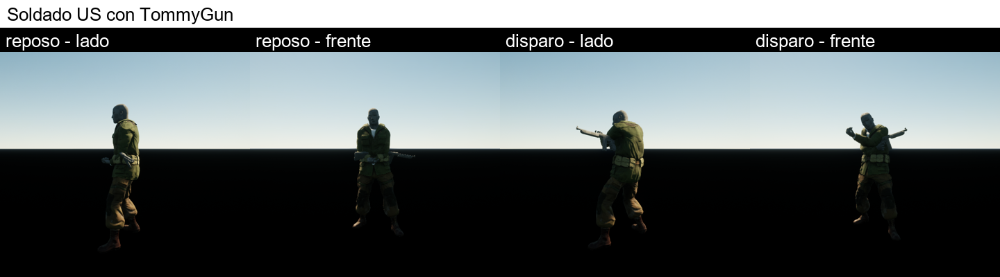
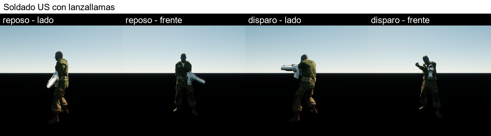
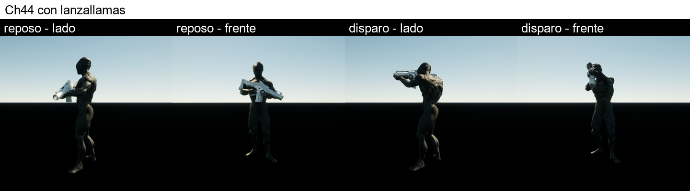
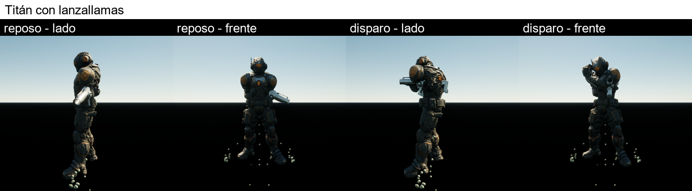

# Cambios del 28 de septiembre de 2026 en in-coming (resumen para leer con calma)

Proyecto: `G:\unitytoue8_pruebas\InComingUE`. La guía de uso detallada de personajes y armas está en
`03-personajes-y-armas.md`; aquí va lo que se hizo y cómo funciona ahora el juego.

## 1. Cómo funciona ahora una partida

| Momento | Qué pasa |
| --- | --- |
| Empieza el nivel | 1 soldado US con su TommyGun |
| Banderola verde (cajas de la izquierda) | Suma soldados del tipo que tengas (US, Ch44 o titán) |
| 1ª banderola amarilla (cajas de la derecha, 40 disparos) | Los soldados cambian al lanzallamas: fuego, daño ×2 |
| 2ª banderola amarilla | El grupo pasa a ser Ch44 con lanzallamas (×2) |
| 3ª banderola amarilla | El grupo pasa a ser titanes con lanzallamas (×3) |
| Oleadas 1 a 4 | Enanos (stickmen) que avanzan por el puente |
| Oleada 5 | El jefe |
| Matas al jefe | Cartel **"¡Nivel 1 superado!"** 3 segundos |
| Nivel 2 | Vuelve a empezar con 1 soldado US y sin lanzallamas; cada oleada trae **el doble de enanos** y el jefe aguanta **el doble** |
| Nivel 3, 4... | Misma regla: nivel N = N veces los enanos y la vida del jefe del nivel 1 |
| Si te matan | Cartel **"Nivel N perdido"** y se repite ese nivel |

Antes, al perder, la partida se quedaba parada sin decir nada (la interfaz de Unity, con su botón de
reintentar, no está convertida): por eso parecía que "ya no salían más hordas".

## 2. Lo que se cambió hoy

| Cambio | Detalle | Dónde se toca |
| --- | --- | --- |
| Personajes del jugador a la mitad | Soldados, Ch44 y titán a escala 0,5 y formación más junta: caben más | Propiedad `PlayerManScale` del componente `HordeCore` del nivel `claude_demo` (0,5 por defecto; se cambia en el panel de detalles sin compilar) |
| Niveles | Ver tabla de arriba | `HordeCore` (`LevelMessageSeconds` = segundos del cartel) y `EnemyWaveSpawner` |
| Lanzallamas con fuego | Ya no son bolas: llamas alargadas y brillantes, de amarillo a rojo, que llegan a unos 9 m, con fogonazo en el impacto | `FlameFx.cpp` y el material `/Game/Unity/Custom/M_Fuego` |
| Orientación y puntería de Ch44 y titán | Miran hacia los enanos y apuntan el arma hacia delante al disparar | Automático en la herramienta de personajes |
| Enanos y jefe cambiables | Por cualquier modelo con rig tipo Mixamo | `personajes.json` (ver guía 03) |
| Fotos de comprobación | Cada personaje en reposo y disparando, de lado y de frente | `python -m unity2ue retratos G:\unitytoue8_pruebas\InComingUE`; copia en `docs\imagenes\` |

## 3. Fotos: cómo llevan el arma

Cada personaje sale en reposo y a mitad del disparo, visto de lado y de frente. En la vista de lado mira hacia la izquierda de la foto, hacia los enanos. Se rehacen con `python -m unity2ue retratos G:\unitytoue8_pruebas\InComingUE`, que las deja en `Unity2UE\retratos`; estas son copias.






Al disparar, todos apuntan hacia delante a la altura del hombro. En reposo el arma cuelga hacia abajo, como en la animación de espera con rifle de Mixamo.

## 4. Cómo convertí el Ch44 en enano (la prueba)

1. Añadí esta entrada en `G:\unitytoue8_pruebas\InComingUE\Unity2UE\personajes.json` (dentro de `"personajes"`):

   ```json
       "PruebaEnano": {
         "fichero": "C:/Users/arico/Downloads/Ch44_nonPBR.fbx",
         "plantilla": "/Game/Unity/RoyalCod/Template_RunnerClash/Prefabs/Units/BP_Man_Enemy",
         "usar_como": "enemigo",
         "mas_alto_cm": -60
       }
   ```

   - `plantilla` es el Blueprint del enano original: así conserva su comportamiento de enemigo.
   - `usar_como: "enemigo"` lo pone como enemigo en los datos del juego (`DA_Horde_Data`).
   - `mas_alto_cm: -60` lo hace 60 cm más bajo que el soldado US.
   - Sin `arma`, va sin arma.

2. Con el editor cerrado, en una terminal en `H:\unitytoue8`:

   ```bat
   python -m unity2ue personajes G:\unitytoue8_pruebas\InComingUE
   ```

   Ese comando:
   - importó el FBX en `Content\Personajes\PruebaEnano`;
   - copió el Blueprint del enano con la malla nueva;
   - le pasó las animaciones del soldado (correr, morir...);
   - lo asignó como enemigo.

3. Le di a Play: cada oleada salía con Ch44 pequeños que avanzaban y caían con los disparos.

4. Para dejarlo como estaba: borré la entrada de `personajes.json` y ejecuté el mismo comando con `--restaurar`, que vuelve a poner los enanos originales:

   ```bat
   python -m unity2ue personajes G:\unitytoue8_pruebas\InComingUE --restaurar
   ```

El jefe se cambia igual, con la plantilla `/Game/Unity/RoyalCod/Template_RunnerClash/Prefabs/Units/BP_Boss_Stickman_2`
y `"usar_como": "jefe"` (ver guía 03, sección 4).

## 5. Puente de hormigón, puertas quitadas y sonidos

- **Puente de hormigón:** losas grises con juntas. La textura se genera con `Unity2UE\custom_textures\make_textures.py` y la aplica el retoque `extra\custom_materials.py`.
- **Puertas quitadas:** ya no están las dos puertas verdes del medio del puente, `Gates_1` y `Gates_2`, que venían del juego de carreras original. Las quita el retoque `extra\quitar_puertas.py`.
- **Sonidos:** los de ahora son **provisionales**; los he generado por síntesis porque el Unity original no traía ninguno. Se cambian por los tuyos con un comando.

| Sonido | Cuándo suena |
| --- | --- |
| `S_Disparo_Rifle` | Cada ráfaga con el rifle |
| `S_Lanzallamas` | Cada ráfaga con el arma de fuego |
| `S_Bloop` | Cada soldado nuevo del jugador (escalonados, cada vez más agudos) |
| `S_Cambio_Arma` | 1ª banderola amarilla (cambio de arma) |
| `S_Cambio_Personaje` | 2ª y 3ª banderola amarilla (Ch44, titán) |
| `S_Enano_Muerto` | Cada enano que cae (y cada golpe al jefe) |
| `S_Jefe_Muerto` | Muere el jefe |
| `S_Nivel_Superado` | Cartel de nivel superado |
| `S_Nivel_Fallido` | Cartel de nivel perdido |

**Poner un sonido tuyo** (con el editor cerrado; tiene que ser `.wav`, Unreal no importa mp3):

```bat
python -m unity2ue sonido G:\unitytoue8_pruebas\InComingUE S_Disparo_Rifle "C:\Users\arico\Downloads\mi_disparo.wav"
```

- Copia tu fichero en `Unity2UE\custom_sounds\S_Disparo_Rifle.wav` y lo reimporta. Ya queda asignado, porque el juego busca ese nombre.
- `python -m unity2ue sonido G:\unitytoue8_pruebas\InComingUE --listar` muestra los nombres.
- **No ejecutes `make_sounds.py`** después de poner los tuyos: regenera los sintéticos y los sobrescribe.

## 6. Banderolas dentro del puente

- **Dónde caen:** cada banderola cae a la altura de su caja (las amarillas desde las cajas de la derecha, las verdes desde las de la izquierda), desplazada lo justo para quedar **entera dentro del ancho del puente**. Así sigue mientras viaja hacia el grupo.
- **Dónde se ajusta:** el ancho es `BridgeHalfWidth` (3 m = medio puente) en el componente `FallingReward` de la banderola.
- **Pendiente:** el grupo sí puede salirse un poco del puente por los lados, porque su carril mide 4 m a cada lado y el puente 3 m. Viene así de Unity (`ArenaHalfWidth` en `DA_Horde_Data`) y lo dejamos para cuando toquemos las dimensiones.

## 7. Cosas a saber

- **Antes de cualquier comando, cierra el editor de Unreal.**
- Para probar sin jugar mucho, en el juego pulsa la tecla **º** (consola) y escribe:
  - `unity2ue.YellowBanner`: siguiente etapa amarilla (lanzallamas, Ch44, titán);
  - `unity2ue.WinLevel`: da el nivel por superado (cartel y siguiente nivel, con el doble de enanos).
- Comprobado en la prueba automática: el nivel 1 empieza con 6 enanos en la 1ª oleada. Al superarlo, el nivel 2 empieza con 12 y luego 20, el doble que en el nivel 1.
- El cartel no sale en las capturas automáticas, porque solo capturan la escena. Míralo tú al jugar.
- El jefe con otro modelo no lo he visto en partida (sale en la oleada 5); revísalo la primera vez.
- El titán tiene unos trocitos flotando bajo los pies (piezas sin pesos de hueso en el modelo; se arregla en Blender).
- Nada de esto está subido a GitHub todavía: dime cuándo quieres el commit.
